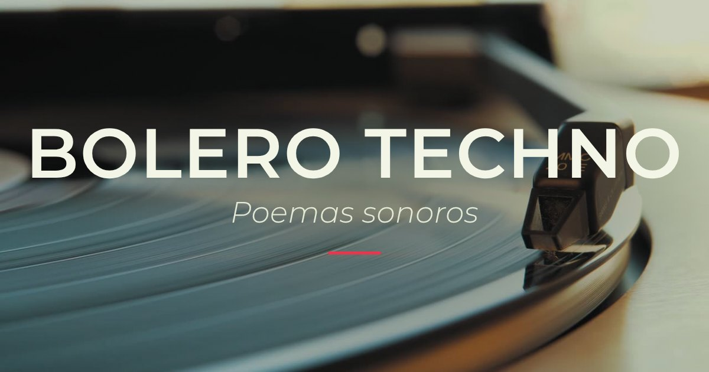

# Bolero Techno

Visita el proyecto en el siguiente enlace:

## **[https://bolerotechno.lidyacota.com](https://bolerotechno.lidyacota.com/)**

Obra de literatura digital de Lidya Cota: veintisiete poemas de Abraham Truxillo musicalizados con inteligencia artificial.

## Sobre la obra

Hay libros que se leen en silencio y libros que piden pista de baile. Cuando leí *Bolero Techno*, el libro de Abraham Truxillo, supe que era de los segundos: sus poemas ya traían música adentro. Hay un bolero que se desvela, un folk de la pobreza, una balada para Peter Pan, un dub que se revuelca en el mar. Quise sacar esa música a la superficie y convertir el libro en una obra de literatura digital.

En mayo de 2025 elegí veintisiete poemas del libro y, para cada uno, imaginé un sonido: el género, el ritmo, los arreglos, la mezcla y el tipo de voz. Con esas decisiones escribí los prompts de inteligencia artificial con los que se generó la música, y luego convertí cada canción en video. Así nacieron piezas que van del bolero y el mambo a la salsa dura y la ranchera, del punk, el ska y el dub al corrido tumbado, el slam, la música del Istmo y la electrónica.

En octubre de 2026 diseñé y construí este sitio para reunirlo todo. Aquí cada poema tiene un segundo cuerpo: puedes escuchar la canción y, justo debajo, leer el poema completo, con sus espacios y sus sangrías tal como Abraham los dispuso en la página. Junto a cada poema está su ficha sonora: el prompt de IA del que salió la música, para que el proceso quede a la vista junto con la obra.

*Bolero Techno* es literatura digital. La poesía sale del libro impreso, pasa por la inteligencia artificial, circula por plataformas digitales y vuelve a preguntarse quién es el autor de una obra, de qué está hecho el lenguaje y cómo llega hoy un poema a sus lectores… y a quienes lo escuchan. No sustituye al libro: lo expande. Lo saca a bailar.

Desde 2024 circulan en internet poemas sueltos convertidos en canciones con IA, casi siempre de autores clásicos. Hasta donde he podido documentar, *Bolero Techno* es una de las primeras obras que toma un libro de poesía ya publicado, de un autor vivo y con su aval, para musicalizarlo con inteligencia artificial y convertirlo en una obra de literatura digital.

En 2026 la obra fue seleccionada para la décima edición de [El Aleph. Festival de Arte y Ciencia de la UNAM](https://sintesis.culturaunam.mx/events/bolero-techno-y-bestiario-marino-literatura-electr%C3%B3nica), que, bajo el lema *Nuevas narrativas*, reflexionó sobre los retos del presente, entre ellos el papel de la inteligencia artificial. Ciudad de México, 2026.

Por cierto, Abraham y yo somos esposos ♥

*Lidya Cota, Ciudad de México, 2026*

## Créditos

**[Lidya Cota](https://www.lidyacota.com/).** Creadora digital mexicana y especialista en software y tecnologías de la información, con experiencia en innovación tecnológica, inteligencia artificial y aprendizaje automático. Une la programación y el diseño de herramientas digitales con la creación de experiencias interactivas, e impulsa la difusión cultural y la narrativa digital desde una mirada técnica y artística.

**[Abraham Truxillo](https://www.abrahamtruxillo.com/).** Poeta, ensayista y narrador mexicano, nacido en 1983. Licenciado en Letras Hispánicas por la UNAM. Autor de *Postales del ventrílocuo* (2011), *Huracán. Antipoema* (2025), *Bestiario marino* (2025) y *Bolero Techno* (2025).

## Poemas

En cada página: la canción en video, el poema completo y su ficha sonora con el prompt de IA.

| # | Poema | Prompt de IA (extracto) |
|---|---|---|
| 01 | [Folk de la pobreza](https://bolerotechno.lidyacota.com/poemas/folk-de-la-pobreza/) | Spoken word with a raspy, hoarse voice over bluesy mexican urban rock instrumentation, live |
| 02 | [Ropero](https://bolerotechno.lidyacota.com/poemas/ropero/) | Children’s music, Light classical, Waltz |
| 03 | [Semblanza](https://bolerotechno.lidyacota.com/poemas/semblanza/) | Liverpool big band, mexican male voice |
| 04 | [Canción vernal](https://bolerotechno.lidyacota.com/poemas/cancion-vernal/) | Mexican ranchera, Mariachi, Traditional Mexican |
| 05 | [Madrigal por la TV](https://bolerotechno.lidyacota.com/poemas/madrigal-por-la-tv/) | afro-jazz drill, new orleans trance, mexican male voice |
| 06 | [Escala](https://bolerotechno.lidyacota.com/poemas/escala/) | anti-folk big band, illbient cumbia |
| 07 | [Meteorito](https://bolerotechno.lidyacota.com/poemas/meteorito/) | Mexican rock, Punk rock, Comedy rock |
| 08 | [9mm](https://bolerotechno.lidyacota.com/poemas/9mm/) | Corridos tumbados, Regional Mexican, Trap corridos |
| 09 | [Good bye](https://bolerotechno.lidyacota.com/poemas/good-bye/) | grunge, Koto Drill And Bass, mexican male voice |
| 10 | [Lyrics](https://bolerotechno.lidyacota.com/poemas/lyrics/) | Grime Surf Rock, boogie-woogie, swing |
| 11 | [Cíclope](https://bolerotechno.lidyacota.com/poemas/ciclope/) | Ska punk, Latin ska, Reggae rock |
| 12 | [Depa punk](https://bolerotechno.lidyacota.com/poemas/depa-punk/) | Punk rock, British punk, Proto-hardcore |
| 13 | [Arritmia](https://bolerotechno.lidyacota.com/poemas/arritmia/) | algorave, Voice should recite with expressive rhythm |
| 14 | [Balada de Otto Lilienthal](https://bolerotechno.lidyacota.com/poemas/balada-de-otto-lilienthal/) | Ambient Noise Wall Chanson, theatrical spoken word, female voice |
| 15 | [Nana del queratocono](https://bolerotechno.lidyacota.com/poemas/nana-del-queratocono/) | harpischord klezmer |
| 16 | [Luna orquesta](https://bolerotechno.lidyacota.com/poemas/luna-orquesta/) | Mambo, 50s Instrumental Latin, perez-prado orquesta |
| 17 | [Arte poética](https://bolerotechno.lidyacota.com/poemas/arte-poetica/) | bossa nova, Sitar Blues |
| 18 | [Bolero techno](https://bolerotechno.lidyacota.com/poemas/bolero-techno/) | Mexican bolero, Latin waltz, Romantic ballad |
| 19 | [Reloj despertador](https://bolerotechno.lidyacota.com/poemas/reloj-despertador/) | Latin alternative, Latin hip hop, Urban fusion |
| 20 | [Limón partido](https://bolerotechno.lidyacota.com/poemas/limon-partido/) | Indie rock, Alternative rock, Synthpop |
| 21 | [Barda](https://bolerotechno.lidyacota.com/poemas/barda/) | Slam poetry |
| 22 | [Alta traición neoliberal](https://bolerotechno.lidyacota.com/poemas/alta-traicion-neoliberal/) | East Coast hip hop, Boom bap, New York rap |
| 23 | [Bacanal](https://bolerotechno.lidyacota.com/poemas/bacanal/) | Salsa dura, Latin salsa, Afro-Caribbean |
| 24 | [Réquiem del ahogado](https://bolerotechno.lidyacota.com/poemas/requiem-del-ahogado/) | Isthmus folk music, Zapotec traditional music, dramatic |
| 25 | [Balada de Peter Pan, el deseoso](https://bolerotechno.lidyacota.com/poemas/balada-de-peter-pan-el-deseoso/) | Urban rap, dark hip hop, ukulele |
| 26 | [Dub surfing](https://bolerotechno.lidyacota.com/poemas/dub-surfing/) | Dancehall dub, Reggae fusion, Dub poetry |
| 27 | [Hits](https://bolerotechno.lidyacota.com/poemas/hits/) | Latin electropop, Synthpop, Electroclash |

## Herramientas y recursos

Suno (prompts de IA para la producción musical); CapCut (edición de los videos); video de stock gratuito de Pexels (imagen de los videos y fondo del sitio); Claude (apoyo en el desarrollo del sitio web); tipografía Montserrat (SIL Open Font License); YouTube y GitHub Pages (publicación).

## Licencia

"Bolero Techno" © 2025–2026 Lidya Cota y Abraham Truxillo, bajo licencia [Creative Commons Atribución-NoComercial-SinDerivadas 4.0 Internacional (CC BY-NC-ND 4.0)](https://creativecommons.org/licenses/by-nc-nd/4.0/deed.es).

## Cómo citar

Cota, Lidya, y Abraham Truxillo. 2025–2026. "Bolero Techno" [obra de literatura digital]. https://bolerotechno.lidyacota.com/

---

## English

Visit the project at the following link:

### **[https://bolerotechno.lidyacota.com/en/](https://bolerotechno.lidyacota.com/en/)**

A work of electronic literature by Lidya Cota: twenty-seven poems by Abraham Truxillo set to music with artificial intelligence. The site and the poems are in Spanish; the About page is also available in English.

### About the work

There are books you read in silence and books that ask for a dance floor. When I read *Bolero Techno*, Abraham Truxillo’s book, I knew it was the second kind: its poems already carried music inside them. There is a sleepless bolero, a folk song of poverty, a ballad for Peter Pan, a dub that tumbles in the sea. I wanted to bring that music to the surface and turn the book into a work of electronic literature.

In May 2025 I chose twenty-seven poems from the book and, for each one, imagined a sound: the genre, the rhythm, the arrangement, the mix, and the type of voice. With those decisions I wrote the artificial intelligence prompts that generated the music, and then turned each song into a video. That is how pieces were born that range from bolero and mambo to salsa and ranchera, from punk, ska, and dub to corridos tumbados, slam, the music of the Isthmus of Tehuantepec, and electronic music.

In October 2026 I designed and built this website to bring it all together. Here each poem has a second body: you can listen to the song and, just below, read the full poem in its original Spanish, with the spacing and indentation Abraham gave it on the page. Next to each poem is its sound sheet: the AI prompt the music came from, so the process stays visible alongside the work.

*Bolero Techno* is electronic literature. Poetry leaves the printed book, passes through artificial intelligence, circulates on digital platforms, and asks again who the author of a work is, what language is made of, and how a poem reaches its readers today… and its listeners. It does not replace the book: it expands it. It takes it out dancing.

Since 2024, individual poems, mostly by classic authors, have been turned into AI-generated songs and shared online. As far as I have been able to document, *Bolero Techno* is one of the first works to take a poetry book already in print, by a living author and with his approval, set it to music with artificial intelligence, and turn it into a work of electronic literature.

In 2026 the work was selected for the tenth edition of [El Aleph. Festival de Arte y Ciencia at UNAM](https://sintesis.culturaunam.mx/events/bolero-techno-y-bestiario-marino-literatura-electr%C3%B3nica), which, under the theme *New Narratives*, reflected on the challenges of the present, among them the role of artificial intelligence. Mexico City, 2026.

By the way, Abraham and I are married ♥

*Lidya Cota, Mexico City, 2026*

### Credits

**[Lidya Cota](https://www.lidyacota.com/).** Mexican digital creator and specialist in software and information technology, with experience in technological innovation, artificial intelligence, and machine learning. She brings together programming and the design of digital tools with the creation of interactive experiences, and promotes cultural outreach and digital storytelling from both a technical and an artistic perspective.

**[Abraham Truxillo](https://www.abrahamtruxillo.com/).** Mexican poet, essayist, and fiction writer, born in 1983. He holds a degree in Hispanic Literature from UNAM. Author of *Postales del ventrílocuo* (2011), *Huracán. Antipoema* (2025), *Bestiario marino* (2025), and *Bolero Techno* (2025).

**Tools:** Suno (AI prompts for music production); CapCut (video editing); free Pexels stock footage (video imagery and site background); Claude (help developing the website); Montserrat typeface (SIL Open Font License); YouTube and GitHub Pages (publishing).

**License:** © 2025–2026 Lidya Cota and Abraham Truxillo, [CC BY-NC-ND 4.0](https://creativecommons.org/licenses/by-nc-nd/4.0/deed.en).

**How to cite:** Cota, Lidya, and Abraham Truxillo. 2025–2026. "Bolero Techno" [work of electronic literature]. https://bolerotechno.lidyacota.com/

---

**Palabras clave / Keywords:** Bolero Techno, Lidya Cota, Abraham Truxillo, literatura digital, literatura electrónica, literatura digital latinoamericana, literatura digital hecha por mujeres, poesía digital, poesía musicalizada, musicalización de poesía, poesía con inteligencia artificial, música con IA, prompts de IA, electropoesía, poesía sonora, videopoesía, poesía mexicana, poesía contemporánea, arte híbrido, literatura y tecnología, El Aleph, UNAM · electronic literature, Latin American electronic literature, electronic literature by women, digital poetry, poetry set to music, AI music, AI prompts, AI and art, Mexican poetry, contemporary poetry, hybrid art.

*Notas técnicas: sitio estático en HTML, CSS y JavaScript, publicado en GitHub Pages. Resumen para modelos de lenguaje en [llms.txt](llms.txt) y texto completo de los poemas en [llms-full.txt](llms-full.txt). Detalles en [LEEME.md](LEEME.md). / Technical notes: static HTML, CSS, and JavaScript site published on GitHub Pages; LLM summary in llms.txt, full poem texts in llms-full.txt, details in LEEME.md (Spanish).*
